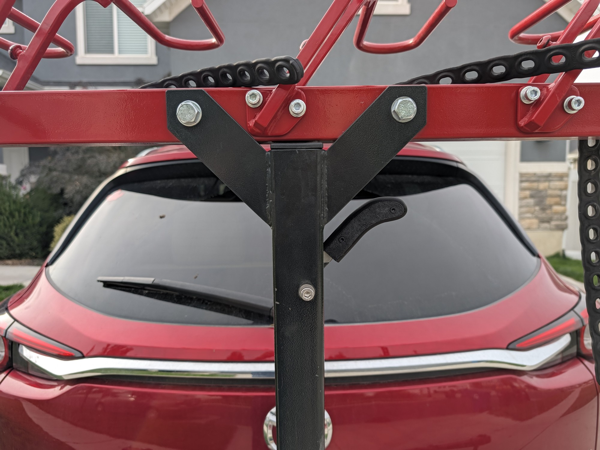

# VelociRAX Bike Rack Handle

3D-printable replacement handle for the original VelociRAX hitch bike rack.
The handle prints as two halves that bolt together around the rack.

Not affiliated with or endorsed by VelociRAX.

## Files

| File | Description |
| --- | --- |
| `cad/rack_handle.f3d` | Fusion source design |
| `stl/rack_handle_half_1.stl` | Handle half 1, with insert pockets (95 × 45 × 11 mm) |
| `stl/rack_handle_half_2.stl` | Handle half 2, with screw counterbores (95 × 45 × 11 mm) |
| `photos/` | Photos of the installed handle, plus background-removed cutouts |
| `bambu/rack_handle_p2s_petg.3mf` | Bambu Studio project: both halves on one plate (P2S, PETG, 0.24 mm) |

## Hardware

- 2× M4 × 12 mm socket head cap screws
- 2× M4 × 4 mm heat-set inserts

## Printing

Printed in PETG with 0.24 mm layers, 4 walls, and 15% infill. ASA also works. Avoid PLA:
the rack sits outside in the sun, where PLA can soften.

Print both halves with the flat outer face on the bed. No supports needed.

## Assembly

1. Press the heat-set inserts into the pockets on the outer face of half 1.
2. Fit the halves together around the rack. Three alignment pins line them up.
3. Insert the M4 × 12 screws through the counterbores in half 2 and tighten them into the inserts.
